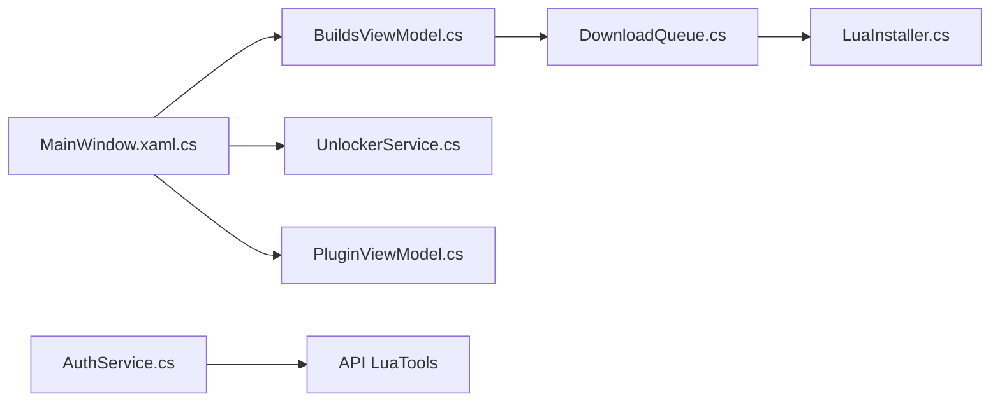

# madoiscool/LuaTools

> Client Windows (WPF, .NET 8) pour gérer des configurations manifest/lua de Steam.

## Le problème
Installer et éditer des manifestes et fichiers lua de Steam sans les manipuler à la main.

## Ce que ça fait vraiment
Parcourt des sources de manifestes, les installe, édite les fichiers `stplug-in` (épinglage de dépôts, activation par dépôt), gère des modes d'« unlocker » et injecte un plugin dans les pages boutique Steam. S'appuie sur DepotDownloaderMod, SteamAutoCrack, Steamless (retire SteamStub) et CloudRedirect. 29 langues, mises à jour par Velopack.

## Comment c'est branché

## Essayer
Aucune commande documentée : téléchargement d'un installateur depuis le site ou les releases.

## Coût et pièges
Gratuit. Dépend d'une API distante et d'outils tiers téléchargés ; le contournement de protections de jeux (SteamStub) expose à des risques juridiques et de compte.

## Ce que ce n'est pas
Pas un outil de développement ni un client Steam officiel.

## Alternatives
Millennium (cadre de plugins Steam dont il reprend l'API d'injection, cité dans le README).

## Pour toi
À ignorer : outil de contournement pour jeux Steam, hors métier et risqué.

