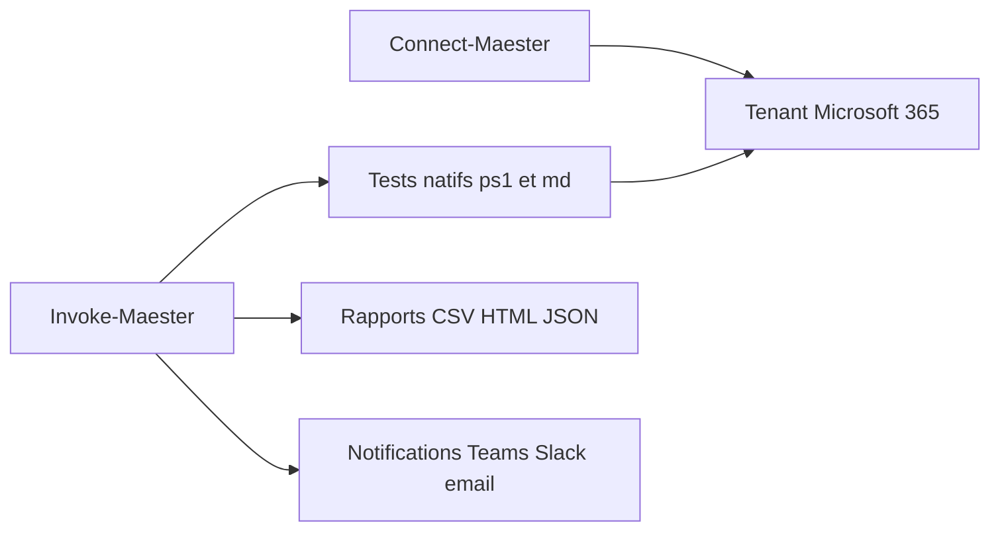

# maester365/maester

> PowerShell test framework to monitor the security configuration of a Microsoft 365 tenant.

## The problem
Microsoft 365 security configuration drifts unnoticed, for lack of regular tests.

## What it actually does
Maester is a PowerShell module shipped with its tests. After `Connect-Maester`, `Invoke-Maester` checks the tenant configuration. Results export to CSV, Excel, HTML, JSON or Markdown, with email, Teams or Slack notifications. You can write your own tests (`Test.*.ps1` and `.md` files) and run it in GitHub, Azure DevOps or GitLab. Maester 3.0, in preview, requires PowerShell 7.4.

## How it is wired
Simplified diagram based on the fiche, no diagram provided.


## Trying it
```powershell
Install-Module -Name Maester -Scope CurrentUser
Connect-Maester
Invoke-Maester
```

## Cost and gotchas
Free, but you need a Microsoft 365 tenant and read permissions. The 3.0 preview breaks compatibility (PowerShell 7.4 minimum). The ExchangeOnlineManagement 3.9.2 module is discouraged.

## What it is not
It is not an automatic remediation tool. The old GitHub action maester365/maester is replaced by maester365/maester-action.

## Alternatives
No alternative named in the README.

## For you
Ignore: only useful if you administer a Microsoft 365 tenant, which is foreign to a data / AI / MLOps profile.
