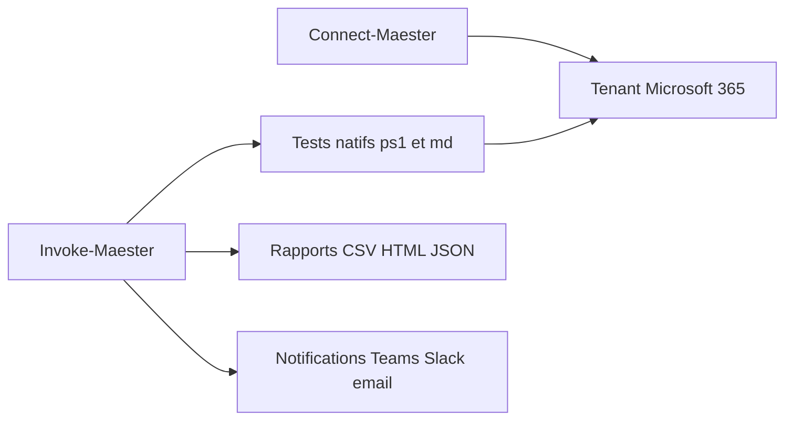

# maester365/maester

> Framework PowerShell de tests pour surveiller la configuration de sécurité d'un tenant Microsoft 365.

## Le problème
La configuration de sécurité de Microsoft 365 dérive sans qu'on s'en aperçoive, faute de tests réguliers.

## Ce que ça fait vraiment
Maester est un module PowerShell livré avec ses tests. Après `Connect-Maester`, `Invoke-Maester` vérifie la configuration du tenant. Les résultats s'exportent en CSV, Excel, HTML, JSON ou Markdown, avec notifications email, Teams ou Slack. On peut écrire ses tests (fichiers `Test.*.ps1` et `.md`) et l'exécuter dans GitHub, Azure DevOps ou GitLab. Maester 3.0, en préversion, exige PowerShell 7.4.

## Comment c'est branché
Schéma simplifié d'après la fiche, sans diagramme fourni.


## Essayer
```powershell
Install-Module -Name Maester -Scope CurrentUser
Connect-Maester
Invoke-Maester
```

## Coût et pièges
Gratuit, mais il faut un tenant Microsoft 365 et des droits de lecture. La préversion 3.0 casse la compatibilité (PowerShell 7.4 minimum). Le module ExchangeOnlineManagement 3.9.2 est déconseillé.

## Ce que ce n'est pas
Ce n'est pas un outil de remédiation automatique. L'ancienne action GitHub maester365/maester est remplacée par maester365/maester-action.

## Alternatives
Aucune alternative nommée dans le README.

## Pour toi
À ignorer : utile seulement si tu administres un tenant Microsoft 365, ce qui est étranger à un profil data / IA / MLOps.

