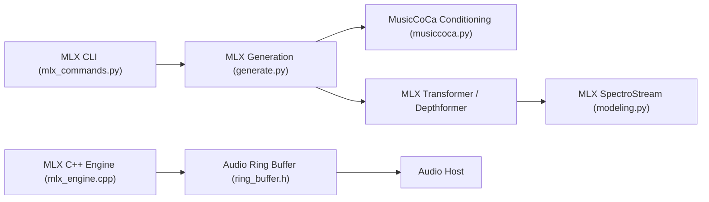

# magenta/magenta-realtime

> Open real-time music generation model, with a Python library and a C++ engine for Mac.

## The problem
Generating streaming music faster than playback requires an optimized inference engine, not just a model.

## What it actually does
Magenta RealTime 2 generates audio tokens autoregressively from a text prompt or MIDI notes (MusicCoCa conditioning), decoded by SpectroStream. Two sizes: `mrt2_small` (230M) and `mrt2_base` (2.4B). `magenta-rt` library (JAX, MLX), `magentart::core` C++ engine for Apple Silicon, AUv3 plugin and example applications.

## How it is wired


## Trying it
```bash
uv venv --python 3.12
source .venv/bin/activate
uv pip install "magenta-rt[mlx]"
mrt models init
mrt models download
mrt mlx generate --prompt "disco funk" --duration 4.0 --model=mrt2_base
```

## Cost and gotchas
Real time: Apple Silicon required; `mrt2_base` requires a Pro/Max chip. Non-real-time: Apple Silicon Mac or NVIDIA GPU through the Python library.

## What it is not
Not a consumer streaming service. Supervised fine-tuning is not shipped ("future updates").

## Alternatives
No alternative named in the README.

## For you
Keep an eye on it: interesting for generative audio if you are on an Apple Silicon Mac; off-topic for a classic data pipeline.
