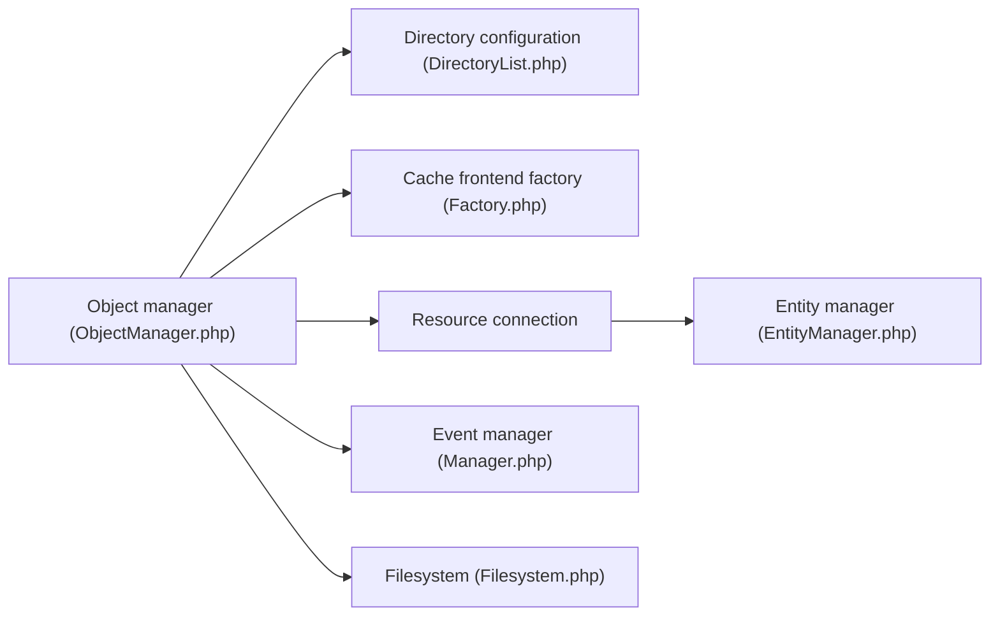

# magento/magento2

> Open source PHP e-commerce platform (Magento Open Source) to build a custom online store.

## The problem
Setting up an extensible online store without starting from scratch.

## What it actually does
Modular PHP platform: framework (object manager, directory configuration, event manager, file system, database resources), catalog with URL rewriting, media storage, tag-based GraphQL cache. The README, for its part, only talks about community, contribution and license; it does not describe installation, only links.

## How it is wired

## Trying it
The README points to a quick start guide and contains no command. No command documented.

## Cost and gotchas
Free, but deployment and hosting are heavy. 2,461 open issues. Adobe steers toward Adobe Commerce, which is paid, for advanced features. Files may be under a commercial agreement instead of the OSL 3.0 license.

## What it is not
Not the full version: Adobe Commerce adds cloud, merchandising AI and analytics. Not lightweight.

## Alternatives
- Adobe Commerce: paid offering, recommended by the README.

## For you
Ignore: e-commerce platform unrelated to data/AI/MLOps, with a copyleft OSL 3.0 license.
