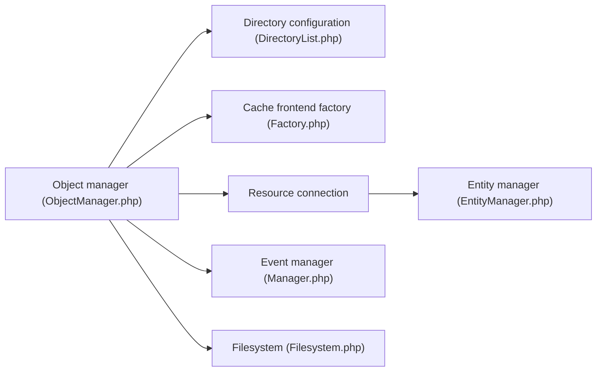

# magento/magento2

> Plateforme e-commerce PHP open source (Magento Open Source) pour construire une boutique en ligne sur mesure.

## Le problème
Monter une boutique en ligne extensible sans partir de zéro.

## Ce que ça fait vraiment
Plateforme modulaire PHP : framework (gestionnaire d'objets, configuration de répertoires, gestionnaire d'événements, système de fichiers, ressources de base de données), catalogue avec réécriture d'URL, stockage média, cache GraphQL par étiquettes. Le README, quant à lui, ne parle que de communauté, contribution et licence ; il ne décrit pas l'installation, seulement des liens.

## Comment c'est branché

## Essayer
Le README renvoie à un guide de démarrage rapide et ne contient aucune commande. Aucune commande documentée.

## Coût et pièges
Gratuit, mais déploiement et hébergement sont lourds. 2 461 issues ouvertes. Adobe oriente vers Adobe Commerce, payant, pour les fonctions avancées. Les fichiers peuvent être sous un contrat commercial en lieu et place de la licence OSL 3.0.

## Ce que ce n'est pas
Pas la version complète : Adobe Commerce ajoute cloud, IA de merchandising et analytique. Pas léger.

## Alternatives
- Adobe Commerce : offre payante, recommandée par le README.

## Pour toi
Ignorer : plateforme e-commerce sans rapport avec la data/IA/MLOps, avec une licence OSL 3.0 copyleft.

