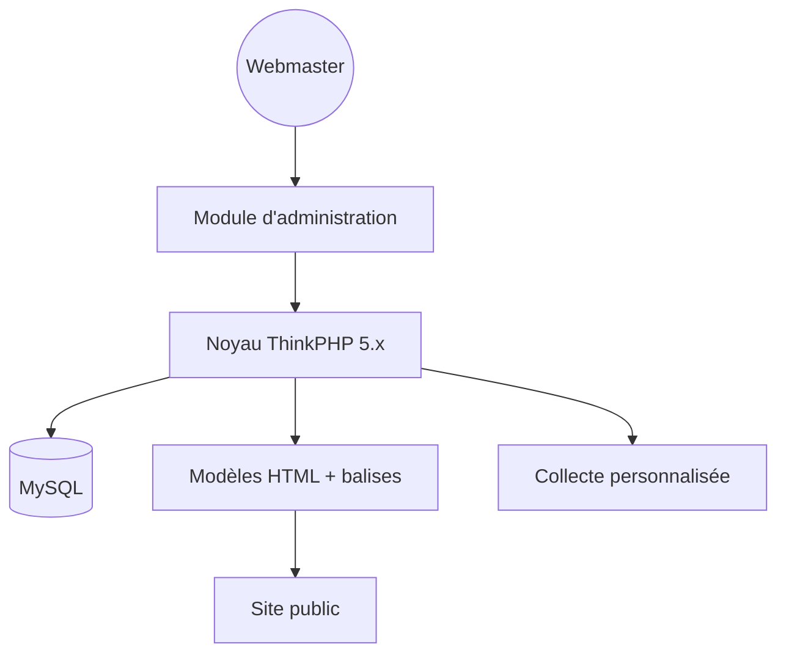

# magicblack/maccms10

> PHP and MySQL content management system for building websites, with custom collection, aimed at webmasters.

## The problem
Quickly set up a content site with separate templates and data collection without developing a homemade CMS, on ordinary shared hosting.

## What it actually does
The README, repeated in nine languages, describes an "Apple CMS" v10 on a ThinkPHP 5.x core. It separates HTML templates from the administration code, and offers built-in tags, an interface for custom function tags and a configurable collection (data retrieval) feature. No installation instructions, no component diagram, no precise feature list is given.

## How it is wired
Simplified diagram based on the sheet, no diagram provided.

## Trying it
No command documented in the README.

## Cost and gotchas
Free. Requires PHP and MySQL. License present but not identified by GitHub: to be checked. The program is shipped without data: content is the user's responsibility, who is liable according to the disclaimer.

## What it is not
It is not a documented solution: no guide in the README, which remains commercial presentation. The disclaimer states "internal learning" use and disclaims any responsibility for content.

## Alternatives
No alternative named in the README.

## For you
Ignore: a PHP CMS documented in a marketing style, unrelated to data, AI or MLOps, with a vague license and a collection feature with an uncertain legal framework.
