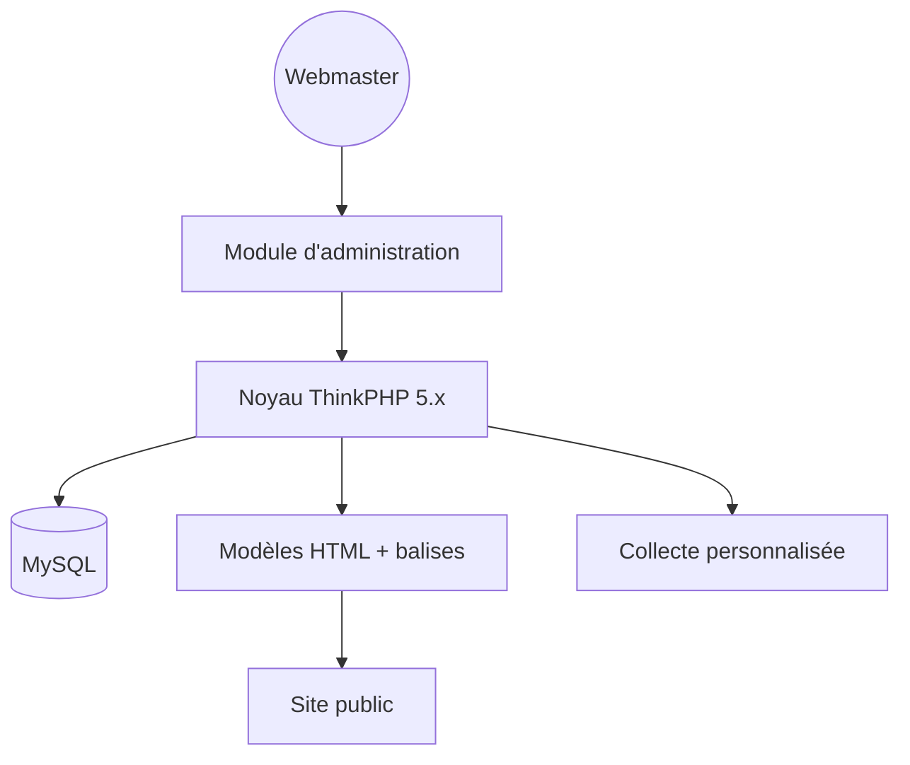

# magicblack/maccms10

> Système de gestion de contenu PHP et MySQL pour monter des sites, avec collecte personnalisée, pour webmasters.

## Le problème
Monter vite un site de contenus avec modèles séparés et collecte de données sans développer un CMS maison, sur un hébergement mutualisé ordinaire.

## Ce que ça fait vraiment
Le README, repris en neuf langues, décrit un CMS « Apple CMS » v10 sur noyau ThinkPHP 5.x. Il sépare les modèles HTML du code d'administration, propose des balises intégrées, une interface de balises de fonctions personnalisées et une fonction de collecte (récupération de données) paramétrable. Aucune instruction d'installation, aucun schéma de composants, aucune liste de fonctions précise n'est donnée.

## Comment c'est branché
Schéma simplifié d'après la fiche, sans diagramme fourni.

## Essayer
Aucune commande documentée dans le README.

## Coût et pièges
Gratuit. Exige PHP et MySQL. Licence présente mais non identifiée par GitHub : à vérifier. Le programme est livré sans données : le contenu est à la charge de l'utilisateur, qui en est responsable selon l'avertissement.

## Ce que ce n'est pas
Ce n'est pas une solution documentée : pas de guide dans le README, qui reste de la présentation commerciale. L'avertissement indique un usage « d'apprentissage interne » et décline toute responsabilité sur les contenus.

## Alternatives
Aucune alternative nommée dans le README.

## Pour toi
À ignorer : un CMS PHP documenté de façon marketing, sans lien avec data, IA ou MLOps, avec licence floue et fonction de collecte au cadre juridique incertain.

