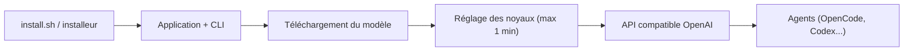

# magnitudedev/magnitude

> Local inference engine that tunes its kernels to your machine to run open models faster.

## The problem
Local engines ship generic kernels, not tuned for your chip, and leave performance on the table.

## What it actually does
When a model is downloaded, Magnitude spends up to a minute testing ways of splitting the computation on your chip and keeps the fastest combination that does not change the output. It bundles speculative decoding, a quantized KV cache and prefix caches shared across sessions. It connects in one click to agents (Pi, OpenCode, Hermes, Codex, Claude Code, Cline…) or through an OpenAI-compatible API. Desktop application and CLI.

Note: the provided architecture describes an end-to-end agent testing framework, unrelated to this README; it is not used.

## How it is wired
Simplified diagram based on the sheet, no diagram provided.


## Trying it
```bash
curl -fsSL https://magnitude.dev/install.sh | sh
```

## Cost and gotchas
Free, no API key; the models you can run depend on your memory (no fixed minimum). Installation goes through `curl | sh`: read the script first. The "2x faster than Ollama" figure comes from the README and points to the author's own benchmarks.

## What it is not
Not a hosted service or a model: it is an engine that runs open models. The claimed speedup is not verified here.

## Alternatives
- Ollama: broader ecosystem, kernels not tuned per machine.
- llama.cpp: the local reference, with no automatic tuning.
- LM Studio: established graphical interface.

## For you
Worth watching: the per-chip tuning idea is interesting for local inference, but the repo dates from June 2026 and the benchmarks remain to be reproduced.
