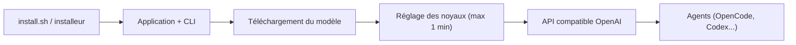

# magnitudedev/magnitude

> Moteur d'inférence local qui règle ses noyaux sur ta machine pour faire tourner des modèles ouverts plus vite.

## Le problème
Les moteurs locaux livrent des noyaux génériques, non réglés pour ta puce, et laissent des performances sur la table.

## Ce que ça fait vraiment
Au téléchargement d'un modèle, Magnitude consacre jusqu'à une minute à tester des découpages du calcul sur ta puce et garde la combinaison la plus rapide qui ne change pas la sortie. Il embarque un décodage spéculatif, un KV quantifié et des caches de préfixe partagés entre sessions. Il se connecte en un clic à des agents (Pi, OpenCode, Hermes, Codex, Claude Code, Cline…) ou via une API compatible OpenAI. Application de bureau et CLI.

Note : l'architecture fournie décrit un framework de tests end-to-end par agents, sans rapport avec ce README ; elle n'est pas utilisée.

## Comment c'est branché
Schéma simplifié d'après la fiche, sans diagramme fourni.


## Essayer
```bash
curl -fsSL https://magnitude.dev/install.sh | sh
```

## Coût et pièges
Gratuit, sans clé d'API ; les modèles dépendent de ta mémoire (pas de minimum fixé). L'installation passe par `curl | sh` : relis le script avant. Le chiffre « 2x plus rapide qu'Ollama » vient du README, il renvoie à des benchmarks de l'auteur.

## Ce que ce n'est pas
Pas un service hébergé ni un modèle : c'est un moteur qui fait tourner des modèles ouverts. Le gain annoncé n'est pas vérifié ici.

## Alternatives
- Ollama : écosystème plus large, noyaux non réglés par machine.
- llama.cpp : référence du local, sans réglage automatique.
- LM Studio : interface graphique établie.

## Pour toi
À surveiller : l'idée de réglage par puce est intéressante pour de l'inférence locale, mais le dépôt date de juin 2026 et les benchmarks restent à reproduire.

