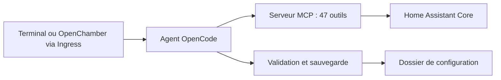

# magnusoverli/opencode

> Home Assistant add-on that integrates the OpenCode agent to edit the configuration in natural language.

## The problem
Writing and fixing Home Assistant YAML, automations and sensors is tedious, and a mistake can prevent startup.

## What it actually does
Add-on (stable and beta, side by side) that opens a web terminal or the OpenChamber interface. It provides 47 MCP tools, 14 resources and 6 prompts: states, services, history, calendars, ESPHome, Supervisor. Validation pipeline: check by HA Core, automatic backup and restore, blocking of mass deletions, approval before direct writes, sensitive files protected. Decision notes and an installation briefing carry over between sessions.

## How it is wired


## Trying it
```bash
# Ajouter le dépôt dans Paramètres → Add-ons → Boutique : https://github.com/magnusoverli/opencode
# Installer « OpenCode », le démarrer, puis dans le terminal :
opencode
/connect
```

## Cost and gotchas
The model provider (Anthropic, OpenAI, Google...) is billed to you; OpenCode Zen is described as free. The add-on has read/write access to the configuration and mounts `/addon_configs`, which is potentially sensitive. An x86-64 CPU with SSE4.2 is required.

## What it is not
Not a product of the OpenCode authors: independent redistribution under MIT. Not a replacement for backups or version control.

## Alternatives
No alternative named in the README.

## For you
Worth watching: a polished example of guardrails around an agent that writes configuration; useful only if you administer Home Assistant.
