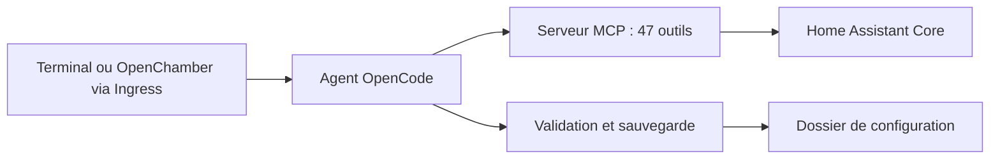

# magnusoverli/opencode

> Add-on Home Assistant qui y intègre l'agent OpenCode pour éditer la configuration en langage naturel.

## Le problème
Écrire et corriger les YAML, automatisations et capteurs de Home Assistant est fastidieux, et une erreur peut empêcher le démarrage.

## Ce que ça fait vraiment
Add-on (stable et bêta, côte à côte) qui ouvre un terminal web ou l'interface OpenChamber. Il fournit 47 outils MCP, 14 ressources et 6 prompts : états, services, historique, calendriers, ESPHome, Supervisor. Pipeline de validation : contrôle par HA Core, sauvegarde et restauration automatiques, blocage des suppressions massives, approbation avant écriture directe, fichiers sensibles protégés. Notes de décision et briefing de l'installation entre les sessions.

## Comment c'est branché


## Essayer
```bash
# Ajouter le dépôt dans Paramètres → Add-ons → Boutique : https://github.com/magnusoverli/opencode
# Installer « OpenCode », le démarrer, puis dans le terminal :
opencode
/connect
```

## Coût et pièges
Le fournisseur de modèle (Anthropic, OpenAI, Google…) est facturé à ta charge ; OpenCode Zen est décrit comme gratuit. L'add-on a un accès en lecture/écriture à la configuration et monte `/addon_configs`, potentiellement sensible. Un CPU x86-64 avec SSE4.2 est requis.

## Ce que ce n'est pas
Pas un produit des auteurs d'OpenCode : redistribution indépendante sous MIT. Pas un remplaçant de sauvegardes ni de contrôle de version.

## Alternatives
Aucune alternative nommée dans le README.

## Pour toi
À surveiller : un exemple abouti de garde-fous autour d'un agent qui écrit de la configuration ; utile seulement si tu administres Home Assistant.

