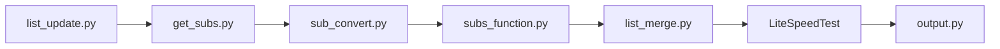

# mahdibland/V2RayAggregator

> Aggregator of public proxy subscription lists, speed-tested and republished in Clash and Base64 formats.

## The problem
Finding working proxy nodes (V2Ray, SS, Trojan...) means digging through scattered sources and testing each node by hand.

## What it actually does
Collects public subscriptions and "airport" subscriptions, converts and validates the nodes, runs them through a speed test (LiteSpeedTest), then publishes mixed, Base64 and Clash outputs. The "public" and "airport" branches are separate. The beginning of the README (installation, usage) could not be read: only the end (table of compatible clients) was.

## How it is wired

## Trying it
No command read in the available part of the README. Not documented here.

## Cost and gotchas
Free, but depends on third-party sources that are out of your control. Public nodes have zero trust: traffic passes through them in clear text for the operator.

## What it is not
Not a VPN or a guaranteed service. No guarantee of availability or node security. Partial sheet: README read only from the end of the file.

## Alternatives
The clients listed in the README (V2rayNG, SagerNet, CFA) consume these lists but do not produce them.

## For you
Unrelated to data/AI/MLOps work, and the sheet is based on a partial README: ignore.
