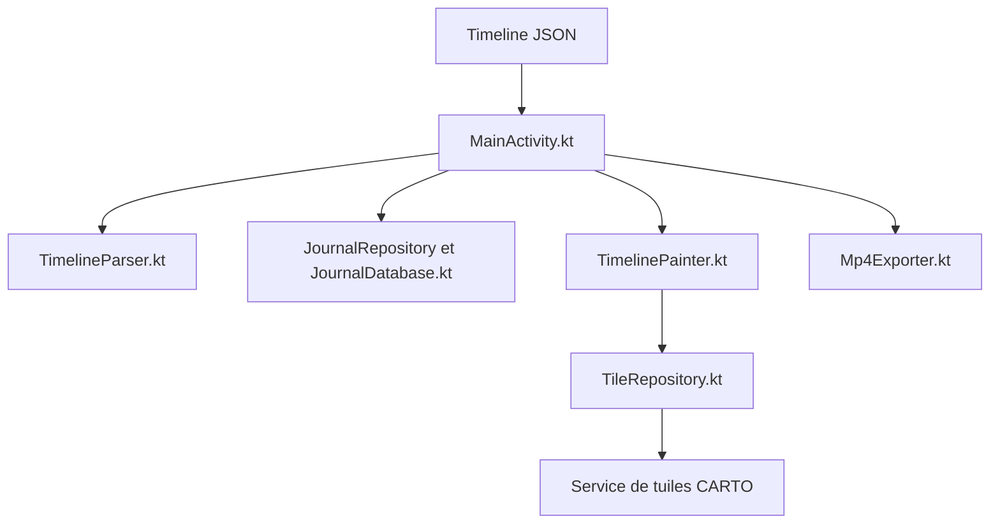

# mahlernim/google-timeline-visualizer

> Turns a Timeline file exported from Google Maps into an animated MP4 trip video, on Android or iPhone web.

## The problem
The location history exported from Google Maps is an unreadable raw JSON file; you want to turn it into a video you can share.

## What it actually does
Imports Timeline.json, filters out aberrant GPS points, keeps a local travel journal, detects trips, previews the animated map, then encodes an MP4 (square, portrait or landscape, 10 to 300 seconds). Flights are interpolated along a great circle. The Android app can be installed from Google Play or as an APK; an iPhone web version and a desktop Python generator also exist.

## How it is wired


## Trying it
```bash
python -m pip install -r requirements.txt
python visualizer.py --input Timeline.json --year 2025 --camera-movement steady \
  --long-trip-compression balanced --output my_trip_2025.mp4
export CARTO_ANDROID_BASEMAP_API_KEY="your-android-key"
./gradlew test lint assembleGithubDebug assemblePlayDebug
```

## Cost and gotchas
Free to use. The base map comes from CARTO: the areas displayed are sent to it, the JSON is not. The Python version requires Python 3.9, FFmpeg and a CARTO key; the Android build requires JDK 17, SDK 36 and a key.

## What it is not
Not a mobility data analysis tool: it only produces a video. It does not read your Google account; you have to export the file yourself.

## Alternatives
No alternative cited in the README.

## For you
Ignore: fun for your own trips, but neither analytical nor reusable in a data pipeline.
