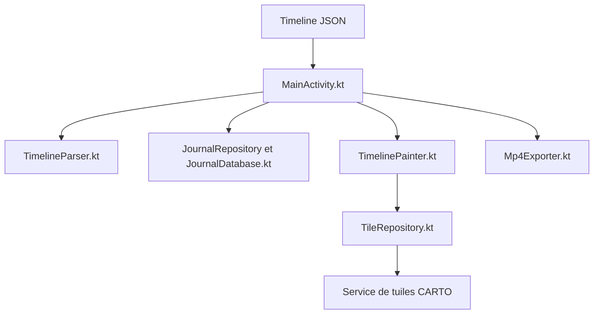

# mahlernim/google-timeline-visualizer

> Transforme un fichier Timeline exporté de Google Maps en vidéo MP4 animée de voyage, sur Android ou web iPhone.

## Le problème
L'historique de localisation exporté de Google Maps est un JSON brut illisible ; on veut en tirer une vidéo à partager.

## Ce que ça fait vraiment
Importe Timeline.json, filtre les points GPS aberrants, tient un journal de voyage local, détecte les trajets, prévisualise la carte animée puis encode un MP4 (carré, portrait ou paysage, 10 à 300 secondes). Les vols sont interpolés sur grand cercle. L'application Android est installable depuis Google Play ou en APK ; une version web iPhone et un générateur Python de bureau existent.

## Comment c'est branché


## Essayer
```bash
python -m pip install -r requirements.txt
python visualizer.py --input Timeline.json --year 2025 --camera-movement steady \
  --long-trip-compression balanced --output my_trip_2025.mp4
export CARTO_ANDROID_BASEMAP_API_KEY="your-android-key"
./gradlew test lint assembleGithubDebug assemblePlayDebug
```

## Coût et pièges
Gratuit à l'usage. Le fond de carte vient de CARTO : les zones affichées lui sont transmises, le JSON ne l'est pas. La version Python demande Python 3.9, FFmpeg et une clé CARTO ; le build Android demande JDK 17, SDK 36 et une clé.

## Ce que ce n'est pas
Pas un outil d'analyse de données de mobilité : il ne produit qu'une vidéo. Il ne lit pas ton compte Google, il faut exporter le fichier toi-même.

## Alternatives
Aucune alternative citée dans le README.

## Pour toi
Ignorer : amusant pour ses propres trajets, mais ni analytique ni réutilisable dans un pipeline data.

