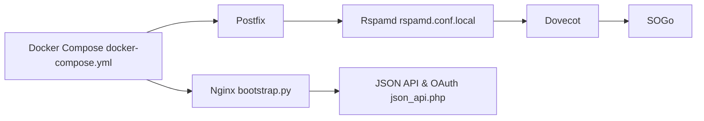

# mailcow/mailcow-dockerized

> Self-hosted mail server stack, shipped as Docker Compose services.

## The problem
Not documented in the README (community links and legal notices only).

## What it actually does
Based on the architecture: Postfix (SMTP), Rspamd (anti-spam), ClamAV, Dovecot (IMAP), SOGo (groupware/webmail).
MySQL, Redis, Unbound (DNS), ACME (certificates), netfilter, Nginx + PHP for administration and a JSON API.
Watchdog, backup, extension hooks; `generate_config.sh` and `update.sh` scripts.

## How it is wired

## Trying it
No command documented in the README.

## Cost and gotchas
Free; running a mail server (DNS, reputation, security) remains demanding.

## What it is not
Not a hosted mail service. "mailcow" is a registered trademark of The Infrastructure Company GmbH.

## Alternatives
No alternative named in the README.

## For you
Ignore: mail infrastructure, unrelated to data or ML.
