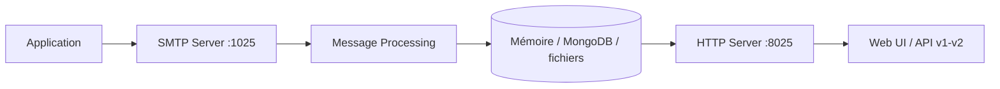

# mailhog/MailHog

> Test SMTP server with a web interface, to see the outgoing emails of an application under development.

## The problem
Testing email sending without risking writing to real recipients is hard with a real server.

## What it actually does
A Go executable that receives SMTP (port 1025 by default), keeps messages in memory (or MongoDB, or files) and shows them in a web interface (port 8025) with real-time updates. HTTP API v1 and v2, basic authentication, releasing messages to a real SMTP server, a `sendmail` replacement (`mhsendmail`) and "Jim", a chaos monkey to simulate sending failures.

## How it is wired


## Trying it
```bash
brew update && brew install mailhog
mailhog
go install github.com/mailhog/MailHog@latest
```

## Cost and gotchas
In-memory storage by default: everything disappears on shutdown. Last push in February 2024; 256 open issues.

## What it is not
It is not a production mail server. It is not an emailing tool.

## Alternatives
MailCatcher: the README says it draws inspiration from it and is simpler to install.

## For you
Worth watching: handy for testing a pipeline's notifications, but with no update for over a year.
