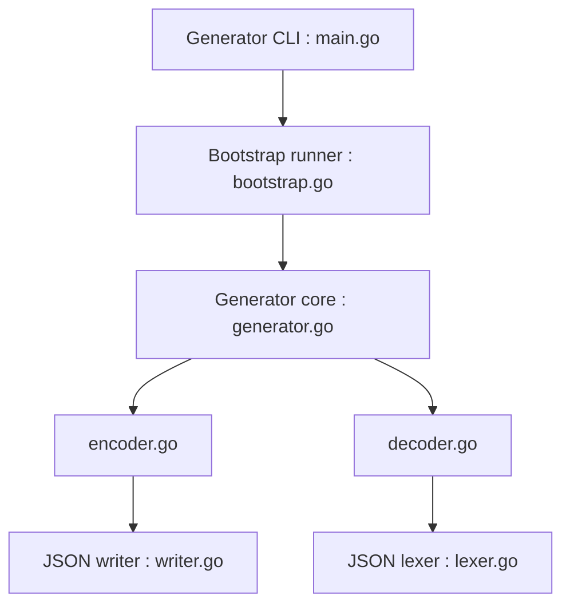

# mailru/easyjson

> Go code generator that serializes structs to JSON without reflection, aimed at performance-sensitive Go services.

## The problem
`encoding/json` relies on reflection and costs time and allocations on large volumes.

## What it actually does
A CLI reads your Go structs, runs a generator and writes an `_easyjson.go` file with marshalers and unmarshalers. The runtime provides a lexer, a writer, a buffer pool and optional wrappers. The README claims 4 to 6 times faster than the stdlib according to its own benchmarks, dated 2016.

## How it is wired


## Trying it
```bash
go get github.com/mailru/easyjson && go install github.com/mailru/easyjson/...@latest
easyjson -all <file>.go
```

## Cost and gotchas
Free. Requires a full Go environment. Uses `unsafe` by default (can be disabled with the `easyjson_nounsafe` tag). Case-sensitive keys, no full validation, no streaming.

## What it is not
Not a transparent drop-in replacement for `encoding/json`: the README itself says some functions are missing. Does not work on `package main` files.

## Alternatives
- encoding/json: the stdlib, with no generation step.
- ffjson: same approach, judged slower and less stable under concurrency by the README.

## For you
Worth watching: only useful if you have a Go service where JSON is measured as a bottleneck; otherwise code generation is not worth the cost.
