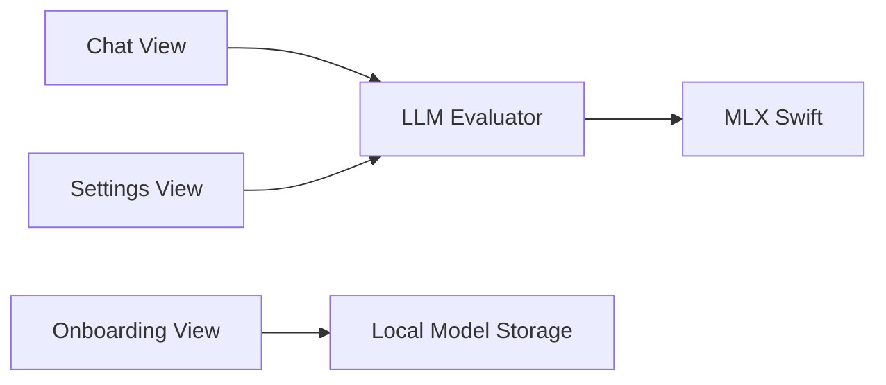

# mainframecomputer/fullmoon-ios

> iOS, iPadOS and macOS app for chatting with local LLMs on Apple chips.

## The problem
Talking to a language model without sending your conversations to the cloud.

## What it actually does
A two-sentence README. From the code: a SwiftUI app with chat, onboarding (device compatibility check, model installation and download) and settings views. An `LLMEvaluator` runs the models through MLX Swift; history stays local. The diagram mentions Llama 3.2 1B and 3B and DeepSeek-R1.

## How it is wired

## Trying it
No command documented in the README.

## Cost and gotchas
Free; Apple silicon hardware and disk space for the models. Last push in May 2025.

## What it is not
Not an online chat service. The README details neither installation nor supported models.

## Alternatives
No alternative named in the README.

## For you
Worth watching: a useful example of an MLX Swift app for local inference, but inactive for over a year and very poorly documented.
