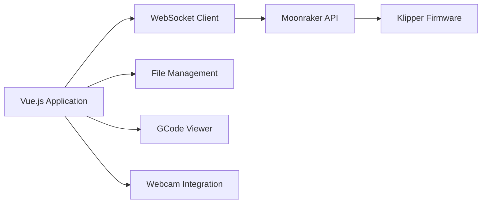

# mainsail-crew/mainsail

> Lightweight, responsive web interface to control a 3D printer running Klipper firmware.

## The problem
Klipper is configured through files and has no comfortable native interface for monitoring and starting prints.

## What it actually does
A Vue/Vuetify application that talks to Moonraker (Klipper's API): file manager and G-code editor, print queue, history, 3D G-code viewer, bed mesh, multiple webcams, timelapse, power control, macros, configurable dashboard, 12 languages. Supports multiple printers.

## How it is wired

(Diagram based on the described architecture, generic.)

## Trying it
No command in the README: setup goes through docs.mainsail.xyz/setup; a remote mode exists at my.mainsail.xyz.

## Cost and gotchas
Free. Requires Klipper and Moonraker to be already installed. Remote mode goes through a hosted service.

## What it is not
Not a firmware nor a slicer: only the interface.

## Alternatives
None named in the README.

## For you
Ignore: 3D printing, unrelated to data/AI/MLOps.
