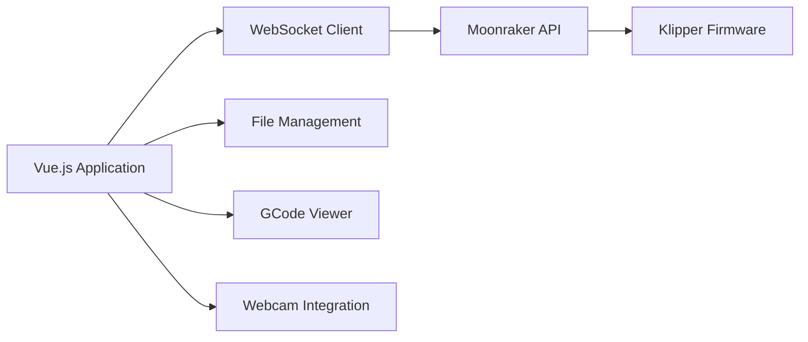

# mainsail-crew/mainsail

> Interface web légère et responsive pour piloter une imprimante 3D sous firmware Klipper.

## Le problème
Klipper se configure en fichiers et n'a pas d'interface native confortable pour surveiller et lancer des impressions.

## Ce que ça fait vraiment
Application Vue/Vuetify qui parle à Moonraker (API de Klipper) : gestionnaire de fichiers et éditeur G-code, file d'impression, historique, visionneuse G-code 3D, maillage du plateau, webcams multiples, timelapse, contrôle d'alimentation, macros, tableau de bord configurable, 12 langues. Prise en charge de plusieurs imprimantes.

## Comment c'est branché

(Schéma d'après l'architecture décrite, générique.)

## Essayer
Aucune commande dans le README : mise en route via docs.mainsail.xyz/setup ; un mode distant existe sur my.mainsail.xyz.

## Coût et pièges
Gratuit. Exige Klipper et Moonraker déjà installés. Le mode distant passe par un service hébergé.

## Ce que ce n'est pas
Pas un firmware ni un logiciel de tranchage : seulement l'interface.

## Alternatives
Aucune nommée dans le README.

## Pour toi
Ignorer : impression 3D, sans lien avec data/IA/MLOps.

