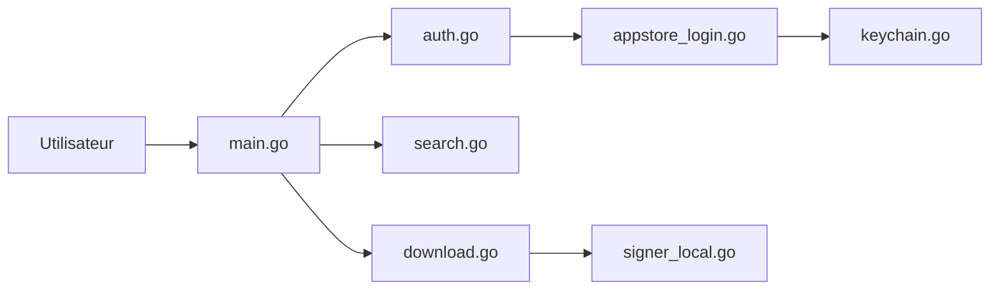

# majd/ipatool

> Command-line tool to search for and download App Store apps as .ipa or .pkg.

## The problem
Getting the package of an Apple application, or an older version, requires going through the official App Store.

## What it actually does
Authenticates an Apple account, searches apps (iOS, iPadOS, tvOS, visionOS, macOS), lists purchases and versions, obtains a license and downloads the package. The code also exposes MCP tools, and an emulated signing module (SAP) is used for downloads. Credentials are stored in the keychain.

## How it is wired


## Trying it
```bash
brew install ipatool
ipatool --help
go build -o ipatool
```

## Cost and gotchas
Free, but requires an Apple account set up for the App Store. Use `--non-interactive` in automation.

## What it is not
It does not bypass purchases: you must own or obtain the license. Depends on Apple's servers.

## Alternatives
- No alternative named in the README.

## For you
Ignore: iOS app distribution tool, with no use in a data/AI workflow; Apple's terms of use should be read.
