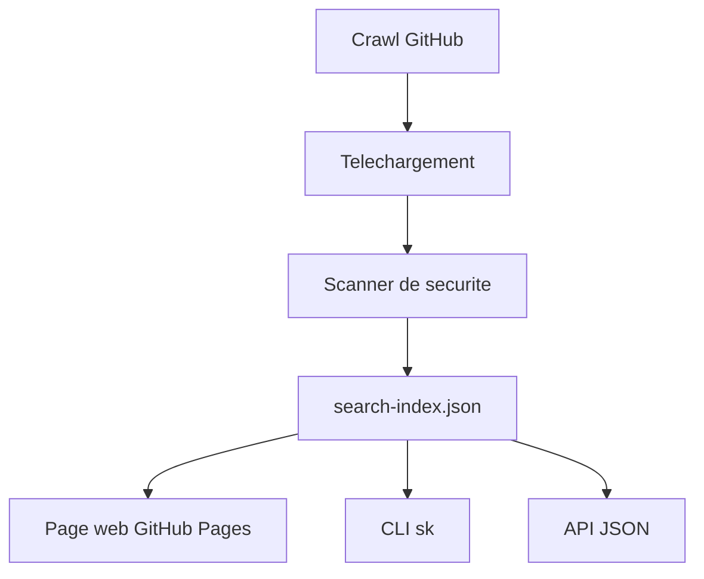

# majiayu000/claude-skill-registry

> Searchable catalog of community Claude Code skills, with an `sk` CLI and a JSON API.

## The problem
Claude Code skills are scattered across many repositories, hard to search and compare.

## What it actually does
Publishes an index of deduplicated skills, categories and quality and security signals, through a search page, a CLI and JSON files. This repository is the generated mirror; the pipeline lives in `claude-skill-registry-core` and the archive in `claude-skill-registry-data`.

## How it is wired


## Trying it
```bash
go install github.com/majiayu000/claude-skill-manager@latest
sk search testing
sk install anthropics/skills/skills/docx
```

## Cost and gotchas
Free, Go required for the CLI. A catalog entry proves neither security nor the right to redistribute: check each skill's license before installing.

## What it is not
Not a skills package by the author: it is an aggregate. Do not open PRs here, they go to the core repository.

## Alternatives
- anthropics/skills: official Anthropic skills.
- SkillsMP: web marketplace for skills.
- awesome-claude-skills: curated list.

## For you
Worth watching: handy for finding a skill to pick up, but choose the skill, not the whole archive, and check its source.
