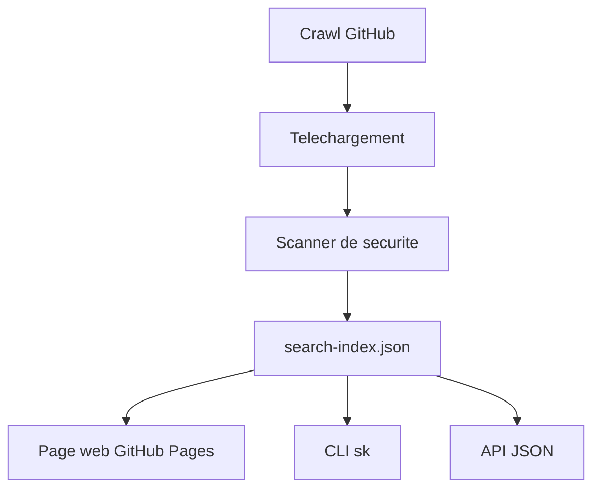

# majiayu000/claude-skill-registry

> Catalogue consultable de skills Claude Code issus de la communauté, avec un CLI `sk` et une API JSON.

## Le problème
Les skills Claude Code sont dispersés dans de nombreux dépôts, difficiles à chercher et à comparer.

## Ce que ça fait vraiment
Publie un index de skills dédupliqués, des catégories et des signaux de qualité et de sécurité, via une page de recherche, un CLI et des fichiers JSON. Ce dépôt est le miroir généré ; le pipeline vit dans `claude-skill-registry-core` et l'archive dans `claude-skill-registry-data`.

## Comment c'est branché


## Essayer
```bash
go install github.com/majiayu000/claude-skill-manager@latest
sk search testing
sk install anthropics/skills/skills/docx
```

## Coût et pièges
Gratuit, Go requis pour le CLI. Une entrée au catalogue ne prouve ni la sécurité ni le droit de redistribuer : relire la licence de chaque skill avant installation.

## Ce que ce n'est pas
Pas un paquet de skills de l'auteur : c'est un agrégat. Ne pas ouvrir de PR ici, elles vont au dépôt core.

## Alternatives
- anthropics/skills : skills officiels d'Anthropic.
- SkillsMP : place de marché web de skills.
- awesome-claude-skills : liste sélectionnée.

## Pour toi
À surveiller : pratique pour chercher un skill à récupérer, mais choisis le skill, pas l'archive entière, et vérifie sa source.

