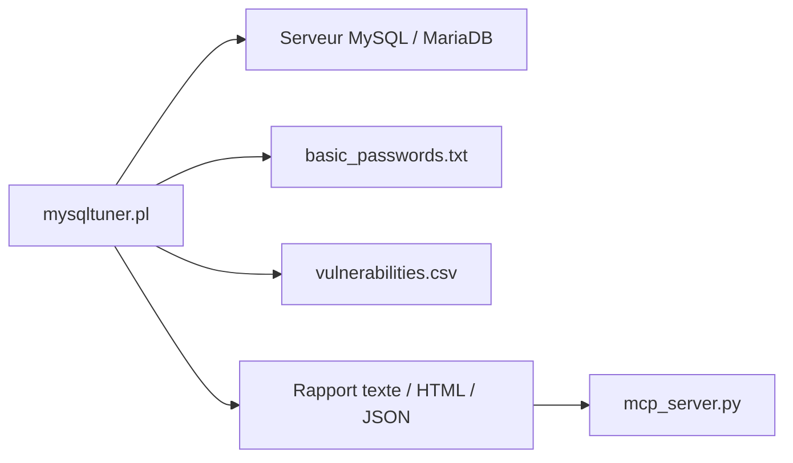

# major/MySQLTuner-perl

> Perl script that audits a MySQL, MariaDB or Percona server and suggests settings, for database admins.

## The problem
Tuning a MySQL server by hand means cross-checking hundreds of variables and statuses. Few people know what is undersized.

## What it actually does
Reads the server's variables and statuses (read-only), then outputs recommendations: memory, InnoDB, security, replication, schema, CVEs. Computes a 0-100 health score and can produce an HTML or JSON report. It never modifies the configuration. The README adds an `--agent-json` mode and an MCP server (build/mcp_server.py) for AI agents.

## How it is wired


## Trying it
```bash
wget https://mysqltuner.pl/ -O mysqltuner.pl
perl mysqltuner.pl --host 127.0.0.1
perl mysqltuner.pl --reportfile=mysqltuner.html
```

## Cost and gotchas
Free. You need a MySQL account with read privileges (GRANT list in the README). Wait for 24 h of uptime: a freshly restarted server gives useless results. Passing the `--pass` option on the command line exposes the password.

## What it is not
Not a tool that fixes things: it only recommends. Not a replacement for the DBA. Unsupported engines: NDB, Archive, Spider, ColumnStore, Connect.

## Alternatives
No alternative named in the README (paid support from LightPath and Releem is cited).

## For you
Adopt: a first MySQL diagnosis in one command, useful for an MLOps profile inheriting a database; apply the advice only after review.
