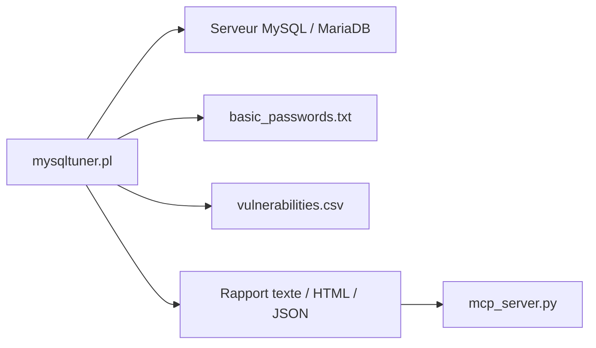

# major/MySQLTuner-perl

> Script Perl qui audite un serveur MySQL, MariaDB ou Percona et propose des réglages, pour les admins de bases.

## Le problème
Régler un serveur MySQL à la main demande de croiser des centaines de variables et de statuts. Peu de gens savent ce qui est sous-dimensionné.

## Ce que ça fait vraiment
Lit variables et statuts du serveur (lecture seule), puis sort des recommandations : mémoire, InnoDB, sécurité, réplication, schéma, CVE. Calcule un score de santé 0-100 et peut produire un rapport HTML ou JSON. Il ne modifie jamais la configuration. Le README ajoute un mode `--agent-json` et un serveur MCP (build/mcp_server.py) pour agents IA.

## Comment c'est branché


## Essayer
```bash
wget https://mysqltuner.pl/ -O mysqltuner.pl
perl mysqltuner.pl --host 127.0.0.1
perl mysqltuner.pl --reportfile=mysqltuner.html
```

## Coût et pièges
Gratuit. Il faut un compte MySQL avec privilèges de lecture (liste GRANT dans le README). Attendre 24 h d'uptime : un serveur fraîchement redémarré donne des résultats inutiles. Passer l'option `--pass` en ligne de commande expose le mot de passe.

## Ce que ce n'est pas
Pas un outil qui corrige : il recommande seulement. Pas un remplaçant du DBA. Moteurs non supportés : NDB, Archive, Spider, ColumnStore, Connect.

## Alternatives
Aucune alternative nommée dans le README (support payant LightPath et Releem cités).

## Pour toi
À adopter : un premier diagnostic MySQL en une commande, utile pour un profil MLOps qui hérite d'une base ; appliquer les conseils après relecture seulement.

