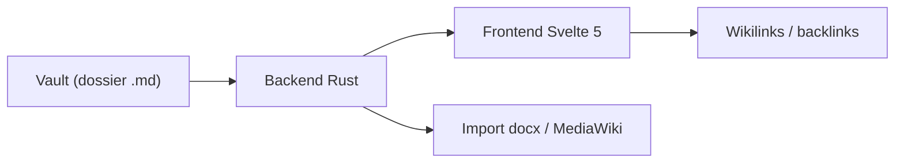

# mak-kirkland/chronicler

> Local offline Markdown wiki for authors and game masters who build worlds.

## The problem
Worldbuilding tools are online, subscription-based, and lock notes into a proprietary database.

## What it actually does
Markdown editor with preview, wikilinks, backlinks, hierarchical tags, infoboxes and templates, image galleries, `||…||` spoilers. Imports `.docx`, MediaWiki/Fandom dumps and Obsidian vaults. Vault diagnostics for broken links. Svelte 5, Rust, Tauri 2. A paid Pro version (maps, timelines, trees) is announced.

## How it is wired
The README describes no architecture beyond the stack (no diagram provided).


## Trying it
```sh
sudo xattr -rd com.apple.quarantine /Applications/chronicler.app
```
Command actually documented, for macOS only. Otherwise: download the release from the Releases page, then create a vault.

## Cost and gotchas
Free for the core; optional community license (themes) and paid Pro coming. Unsigned installers (Windows, macOS). The project lives on donations.

## What it is not
Not open source: the repo is "source-available" under PolyForm Shield 1.0.0, and the README says it cannot be modified or redistributed, which differs from the text of that license: to be verified. GitHub does not recognize the license.

## Alternatives
- Obsidian: reads the same vaults, with plugins for worldbuilding.
- World Anvil, Notion, Campfire: cited for comparison, cloud or module-based solutions.

## For you
Ignore: a writing tool unrelated to data/AI/MLOps, with an ambiguous license and a single maintainer.
