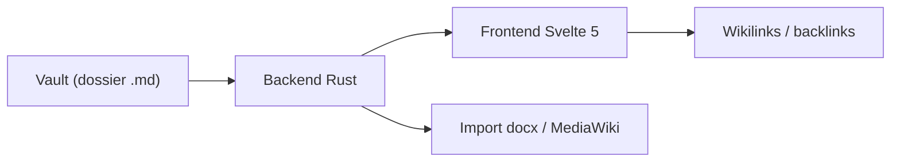

# mak-kirkland/chronicler

> Wiki local hors ligne en Markdown pour auteurs et maîtres de jeu qui construisent des mondes.

## Le problème
Les outils de worldbuilding sont en ligne, par abonnement, et enferment les notes dans une base propriétaire.

## Ce que ça fait vraiment
Éditeur Markdown avec aperçu, wikilinks, rétroliens, tags hiérarchiques, infoboîtes et modèles, galeries d'images, spoilers `||…||`. Import de `.docx`, de dumps MediaWiki/Fandom et de coffres Obsidian. Diagnostic de coffre pour liens cassés. Svelte 5, Rust, Tauri 2. Une version Pro payante (cartes, chronologies, arbres) est annoncée.

## Comment c'est branché
Le README ne décrit pas d'architecture au-delà de la pile (aucun diagramme fourni).


## Essayer
```sh
sudo xattr -rd com.apple.quarantine /Applications/chronicler.app
```
Commande réellement documentée, pour macOS seulement. Sinon : télécharger la version depuis la page des Releases, puis créer un coffre.

## Coût et pièges
Gratuit pour le cœur ; licence communautaire optionnelle (thèmes) et Pro payante à venir. Installateurs non signés (Windows, macOS). Le projet vit de dons.

## Ce que ce n'est pas
Pas open source : le dépôt est « source-available » sous PolyForm Shield 1.0.0, et le README dit qu'on ne peut ni modifier ni redistribuer, ce qui diffère du texte de cette licence : à vérifier. GitHub ne reconnaît pas la licence.

## Alternatives
- Obsidian : lit les mêmes coffres, avec plugins pour le worldbuilding.
- World Anvil, Notion, Campfire : cités en comparaison, solutions cloud ou par module.

## Pour toi
À ignorer : outil d'écriture sans lien avec data/IA/MLOps, avec une licence ambiguë et un mainteneur unique.

