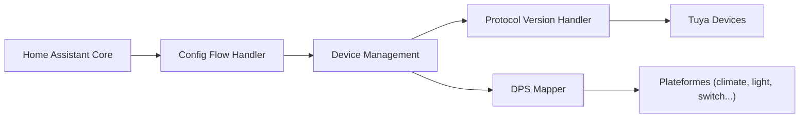

# make-all/tuya-local

> Home Assistant integration that controls Tuya devices locally, without going through their cloud.

## The problem
Tuya devices go through the manufacturer's cloud: latency, dependency, and features that are sometimes not exposed.

## What it actually does
It connects to devices over WiFi (or via a gateway) using their ID and local key, protocols 3.1 to 3.5. More than 1000 models are described by configuration files. A setup assisted by the Tuya cloud retrieves the keys. It also handles IR/RF blasters, locks and pet feeders.

## How it is wired

## Trying it
Install via HACS (custom repository), then Settings → Devices & services → Add integration. No shell command in the README.

## Cost and gotchas
Free, but Home Assistant is required. Many devices accept only one local connection; sending too many commands can make them restart.

## What it is not
Not a security measure: devices keep sending their state to the Tuya cloud. The assisted setup requires authenticating to the cloud.

## Alternatives
- rospogrigio/localtuya: simpler to set up for a device not supported here.

## For you
Ignore for your line of work: it is home automation, only useful if you have Home Assistant at home.
