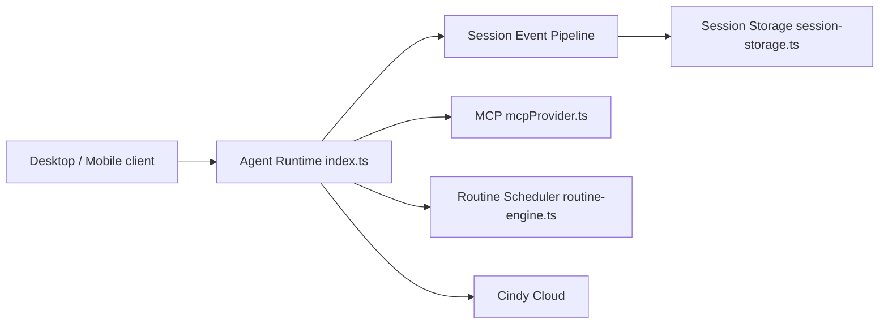

# makecindy/cindy

> Open-source desktop and mobile client for an AI agent that orchestrates Claude Code, Codex and other models over your files.

## The problem
Agent harnesses (Claude Code, Codex) are separate: memory, skills and tools are not shared from one agent or model to another.

## What it actually does
An Electron and Expo client that launches local agents, keeps memory, skills, MCP and scheduled tasks across harnesses, and can split planning, execution and review across harness × model combinations. It drives the browser, the computer and the phone. The backend is in a separate repository, not published here.

## How it is wired


## Trying it
```bash
git clone https://github.com/makecindy/cindy.git
cd cindy
git lfs pull
pnpm install
pnpm restart:desktop:remote --region=global
```

## Cost and gotchas
Node 22, pnpm 10 (not 11), Git LFS. By default the client connects to the official Cindy servers (pay-as-you-go service); "Skip Sign-In" gives local agents without the server features. Official builds send TapDB statistics and a heartbeat once connected.

## What it is not
Not a standalone product: the backend is not in the repository. Plugins and team skill sharing are "in preparation".

## Alternatives
None named in the README, apart from Claude Code and Codex which it wraps.

## For you
Keep an eye on it: the idea of memory shared across harnesses is interesting, but the cloud dependency and the telemetry of official builds weigh against it.
