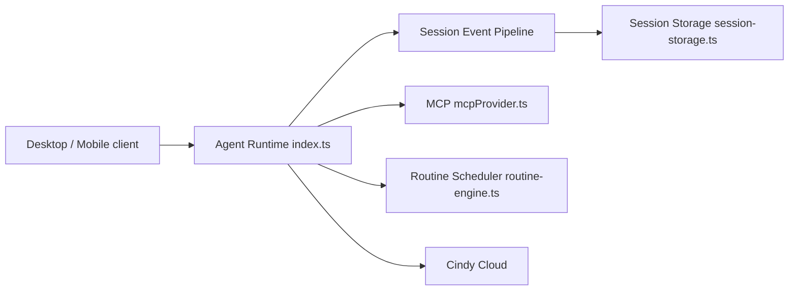

# makecindy/cindy

> Client bureau et mobile open source d'un agent IA qui orchestre Claude Code, Codex et d'autres modèles sur tes fichiers.

## Le problème
Les harnais d'agents (Claude Code, Codex) sont séparés : mémoire, skills et outils ne se partagent pas d'un agent ou d'un modèle à l'autre.

## Ce que ça fait vraiment
Un client Electron et Expo qui lance des agents locaux, conserve mémoire, skills, MCP et tâches planifiées d'un harnais à l'autre, et peut répartir plan, exécution et revue entre combinaisons harnais × modèle. Il pilote navigateur, ordinateur et téléphone. Le backend est dans un dépôt séparé, non publié ici.

## Comment c'est branché


## Essayer
```bash
git clone https://github.com/makecindy/cindy.git
cd cindy
git lfs pull
pnpm install
pnpm restart:desktop:remote --region=global
```

## Coût et pièges
Node 22, pnpm 10 (pas 11), Git LFS. Par défaut le client se connecte aux serveurs officiels Cindy (service facturé à l'usage) ; « Skip Sign-In » donne les agents locaux sans les fonctions serveur. Les builds officiels envoient des statistiques TapDB et un heartbeat une fois connecté.

## Ce que ce n'est pas
Pas un produit autonome : le backend n'est pas dans le dépôt. Les plugins et le partage de skills d'équipe sont « en préparation ».

## Alternatives
Aucune nommée dans le README, hors Claude Code et Codex qu'il enveloppe.

## Pour toi
À surveiller : l'idée de mémoire partagée entre harnais est intéressante, mais la dépendance au cloud et la télémétrie des builds officiels pèsent.

