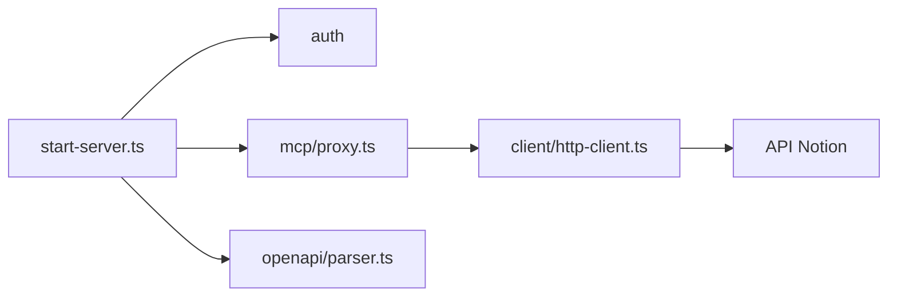

# makenotion/notion-mcp-server

> Self-hosted MCP server that gives AI agents access to the Notion API.

## The problem
An AI agent cannot read or edit a Notion workspace without going through the API and suitable tools.

## What it actually does
A Node.js and TypeScript server that exposes 22 tools derived from Notion's OpenAPI specification: queries on data sources, pages, comments, and reading or editing pages in markdown. It runs over stdio or over HTTP with a bearer token, and can serve several integrations by passing the token through.

## How it is wired


## Trying it
```bash
npx -y @notionhq/notion-mcp-server
npx @notionhq/notion-mcp-server --transport http --auth-token "your-secret-token"
npm run build
npm test
```

## Cost and gotchas
Free, but you need an internal Notion integration, a `NOTION_TOKEN` token, and the pages must be shared with the integration. The README advises against this repository, which is no longer actively maintained or supported, in favor of Notion's remote MCP server, and says it may be discontinued.

## What it is not
It is not the server Notion recommends: the README says so explicitly. It offers fewer tools, keyword-only search and no semantic search.

## Alternatives
Remote Notion MCP, the official hosted server, presented as faster and cheaper in tokens.

## For you
Worth watching only as a fallback: the publisher itself points to its remote server, so prefer that one for lasting use.
