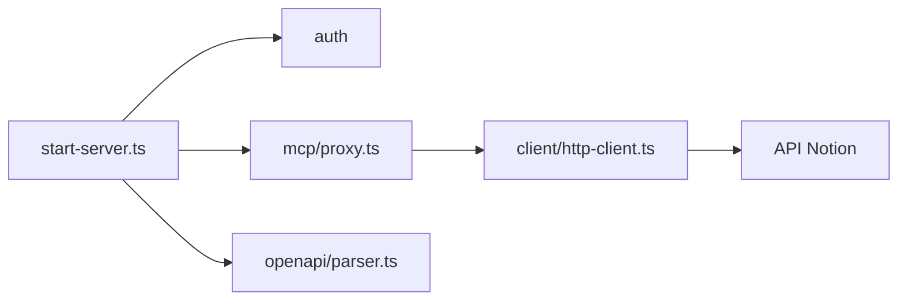

# makenotion/notion-mcp-server

> Serveur MCP auto-hébergé qui donne aux agents IA un accès à l'API Notion.

## Le problème
Un agent IA ne peut pas lire ni modifier un espace Notion sans passer par l'API et des outils adaptés.

## Ce que ça fait vraiment
Serveur Node.js et TypeScript qui expose 22 outils dérivés de la spécification OpenAPI de Notion : requêtes sur sources de données, pages, commentaires, et lecture ou édition de pages en markdown. Il fonctionne en stdio ou en HTTP avec jeton porteur, et sait servir plusieurs intégrations avec passage de jeton.

## Comment c'est branché


## Essayer
```bash
npx -y @notionhq/notion-mcp-server
npx @notionhq/notion-mcp-server --transport http --auth-token "your-secret-token"
npm run build
npm test
```

## Coût et pièges
Gratuit, mais il faut une intégration Notion interne, un jeton `NOTION_TOKEN` et le partage des pages à l'intégration. Le README déconseille ce dépôt, qui n'est plus activement maintenu ni supporté, au profit du serveur MCP distant de Notion, et annonce qu'il pourrait être arrêté.

## Ce que ce n'est pas
Ce n'est pas le serveur recommandé par Notion : le README le dit explicitement. Il offre moins d'outils, une recherche par mot-clé seulement et aucune recherche sémantique.

## Alternatives
Remote Notion MCP, serveur hébergé officiel, présenté comme plus rapide et moins coûteux en jetons.

## Pour toi
À surveiller seulement en repli : l'éditeur lui-même oriente vers son serveur distant, donc préfère celui-là pour un usage durable.

