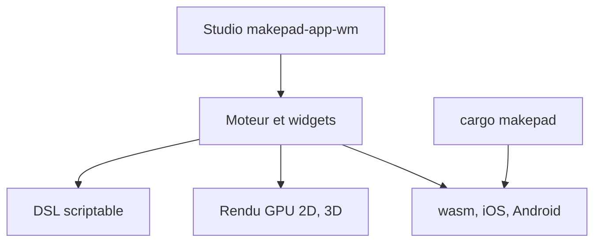

# makepad/makepad

> Rust environment for developing applications and games, with a UI runtime, a scriptable DSL and AI backends.

## The problem
Building a native and web interface in Rust with a fast feedback loop requires gluing several tools together.

## What it actually does
A repository with engine, widgets, tools and examples: a cross-platform UI runtime (native and web), a live-editable design DSL, 2D and 3D GPU rendering (glTF), maps, speech analysis with Whisper, and a "Studio" to inspect the examples. Several AI backends are announced for embedding LLMs or generative models; the README does not detail their usage.

## How it is wired
Simplified diagram based on the sheet, no diagram provided.



## Trying it
```bash
cargo run -p makepad-app-wm --release
cargo run -p makepad-app-storybook --release
cargo run -p makepad-example-splash --release
cargo install --path=./tools/cargo_makepad
cargo makepad wasm run -p makepad-example-splash --release
```

## Cost and gotchas
Free. Real need: Rust toolchain and many system dependencies on Linux (script `tools/linux_deps.sh`), plus the mobile and wasm target toolchains. Compilation is heavy.

## What it is not
Not an ML framework or a model server: the AI backends are only mentioned. Not a lightweight library to add to an existing app.

## Alternatives
No alternative named in the README.

## For you
Worth watching: relevant for a native Rust app with local AI, but too heavy and specific for everyday data use.
