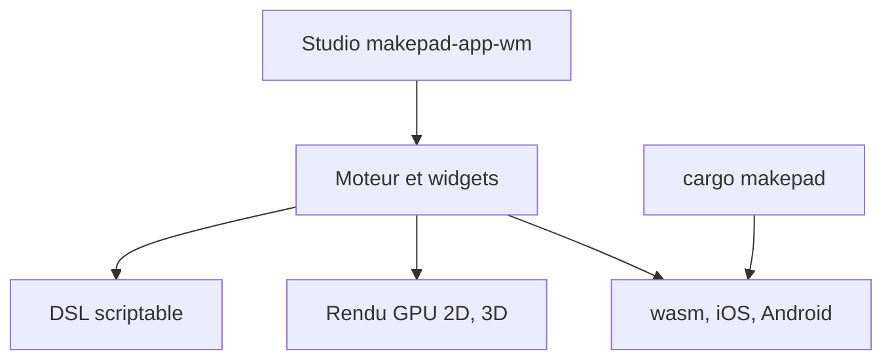

# makepad/makepad

> Environnement Rust de développement d'applications et de jeux, avec runtime UI, DSL scriptable et backends IA.

## Le problème
Construire une interface native et web en Rust avec une boucle de retour rapide demande de recoller plusieurs outils.

## Ce que ça fait vraiment
Dépôt avec moteur, widgets, outils et exemples : runtime UI multiplateforme (natif et web), DSL de design éditable en direct, rendu GPU 2D et 3D (glTF), cartes, analyse vocale avec Whisper, et un « Studio » pour inspecter les exemples. Plusieurs backends IA sont annoncés pour embarquer des LLM ou des modèles génératifs ; le README ne détaille pas leur usage.

## Comment c'est branché
Schéma simplifié d'après la fiche, sans diagramme fourni.



## Essayer
```bash
cargo run -p makepad-app-wm --release
cargo run -p makepad-app-storybook --release
cargo run -p makepad-example-splash --release
cargo install --path=./tools/cargo_makepad
cargo makepad wasm run -p makepad-example-splash --release
```

## Coût et pièges
Gratuit. Besoin réel : toolchain Rust et nombreuses dépendances système sur Linux (script `tools/linux_deps.sh`), plus les toolchains de cibles mobiles et wasm. La compilation est lourde.

## Ce que ce n'est pas
Pas un framework de ML ni un serveur de modèles : les backends IA ne sont que mentionnés. Pas une bibliothèque légère à ajouter à une appli existante.

## Alternatives
Aucune alternative nommée dans le README.

## Pour toi
À surveiller : pertinent pour une appli native Rust avec IA locale, mais trop lourd et spécifique pour un usage data courant.

