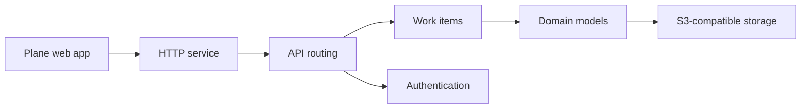

# makeplane/plane

> Open-source project management tool: tickets, cycles, modules, and roadmaps.

## The problem
Using a complex tool to track tickets and work logs wastes time managing the tool itself.

## What it actually does
Features include a rich editor, progress-tracking cycles, modules, shareable filtered views, pages with AI capabilities, and analysis tools. The application is a web application, with a public space and an administration console (God mode) built on top of a Django API, with S3 or MinIO-compatible storage.

## How it is wired

## Trying it
The README does not contain instructions for installing Docker or Kubernetes using the documentation, or for signing up for Plane Cloud.

## Cost and gotchas
Plane Cloud offers a free account; free self-hosting. License: AGPL-3.0. Several links in the README are images without text, which limits the available content.

## What it is not
It's not a tool for tracking machine learning experiments; it's a generic task tracker.

## Alternatives
No alternative is specified in the README.

## For you
Things to watch out for: an alternative self-hosted solution for managing a team project, without direct involvement in data science.
