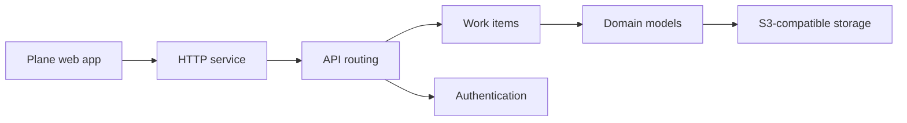

# makeplane/plane

> Outil de gestion de projet open source : tickets, cycles, modules et feuilles de route.

## Le problème
Suivre tickets et feuilles de route dans un outil lourd fait perdre du temps à gérer l'outil lui-même.

## Ce que ça fait vraiment
Éléments de travail avec éditeur riche, cycles avec courbes d'avancement, modules, vues filtrées partageables, pages avec capacités d'IA, analyses. Application web, espace public (Space) et console d'administration (God mode) au-dessus d'une API Django, avec stockage compatible S3 ou MinIO.

## Comment c'est branché

## Essayer
Le README ne contient pas de commande : installation Docker ou Kubernetes via la documentation, ou inscription à Plane Cloud.

## Coût et pièges
Plane Cloud propose un compte gratuit ; auto-hébergement gratuit. Licence AGPL-3.0. Plusieurs liens du README sont des images sans texte, d'où une matière limitée.

## Ce que ce n'est pas
Pas un outil de suivi d'expériences ML : c'est un tracker de tâches générique.

## Alternatives
Aucune alternative nommée dans le README.

## Pour toi
À surveiller : alternative auto-hébergeable pour piloter un projet d'équipe, sans lien direct avec la science des données.

