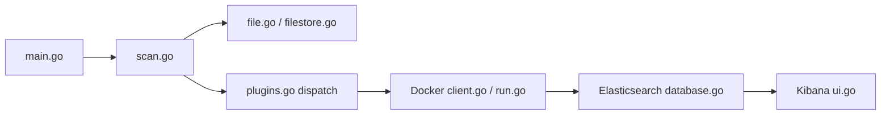

# maliceio/malice

> A malware analysis framework in Docker, a sort of self-hosted VirusTotal, for researchers and security teams.

## The problem
Analyzing a suspicious file with several engines means installing them and aggregating their results by hand, or going through an online service.

## What it actually does
- A Go CLI (`main.go`): `scan` a file, `watch` a folder, `lookup` a hash, `plugin` to manage plugins, `elk` to launch the interface.
- The file is recorded (metadata, shared volume) then sent to analysis plugins, each in a Docker container, chosen by MIME type.
- Results are stored in Elasticsearch and viewable in Kibana; a Markdown output is also produced.
- Archived repository, last push in April 2023.

## How it is wired


## Trying it
```bash
brew install maliceio/tap/malice
malice scan evil.malware
malice elk
# ou en Docker :
docker run --rm -v /var/run/docker.sock:/var/run/docker.sock malice/engine plugin update --all
```

## Cost and gotchas
About 16 GB of disk and 4 GB of RAM, Docker required; Elasticsearch is hungry (`vm.max_map_count` setting on Linux). Docker-in-Docker mode mounts the Docker socket: broad access to the host. VirusTotal key optional.

## What it is not
It is not a maintained service: the repository is archived. To be handled only in an isolated environment, since it is used to open real malware samples. The public demo mentions credentials in clear text, unrelated to real use.

## Alternatives
No alternative named in the README, except VirusTotal, of which it aims to be the free version.

## For you
Ignore: archived since 2023, heavy to host and with no direct link to data/MLOps work; useful only as an example of a containerized plugin architecture.
