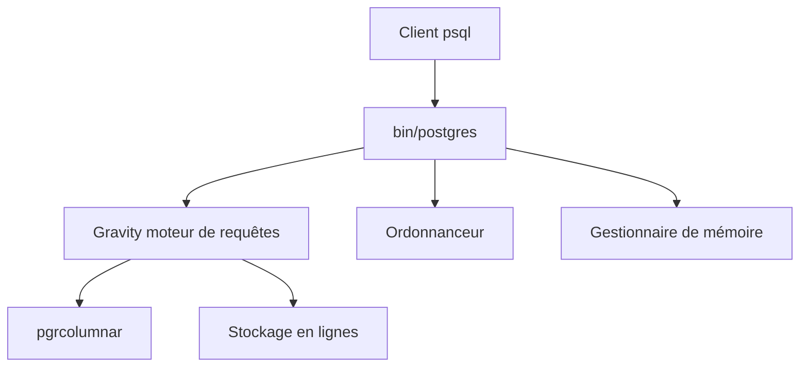

# malisper/pgrust

> Rewrite of PostgreSQL in Rust, protocol- and SQL-compatible, with a columnar analytics engine.

## The problem
Postgres is slow at analytics and fragile when memory is exhausted or queries are greedy.

## What it actually does
Rust server compatible with Postgres 18.6: Gravity engine (vectorized, JIT-compiled), threads instead of processes, a query scheduler, a memory manager that cancels the greediest query, `pgrcolumnar` columnar storage. Claims up to 1,600 times faster than PostgreSQL on ClickBench. Ships pgvector, pg_cron and most of contrib.

## How it is wired
Simplified diagram based on the sheet, no diagram provided.



## Trying it
```bash
docker run -d --name pgrust -e POSTGRES_PASSWORD=secret -p 5432:5432 malisper/pgrust:v0.4-beta
psql -h localhost -p 5432 -U postgres
```

## Cost and gotchas
Free. The `latest` tag still points to v0.3; v0.3 columnar tables require a dump and restore. UTF8 is the only encoding. ON CONFLICT and MERGE are not supported in columnar.

## What it is not
Not production-ready, by the authors' own admission: keep Postgres as the source of truth. External extensions do not work directly.

## Alternatives
The README simply recommends PostgreSQL for production; ClickHouse is cited as a performance comparison.

## For you
Worth watching: strong promise for analytics on Postgres SQL, but beta and AGPL-licensed.
