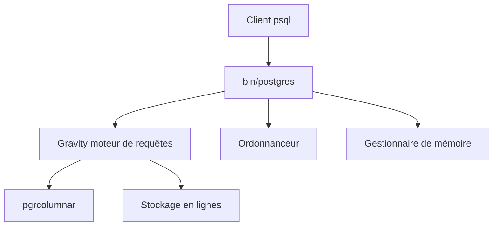

# malisper/pgrust

> Réécriture de PostgreSQL en Rust, compatible protocole et SQL, avec moteur analytique colonnaire.

## Le problème
Postgres est lent sur l'analytique et fragile face à la mémoire saturée ou aux requêtes gourmandes.

## Ce que ça fait vraiment
Serveur Rust compatible Postgres 18.6 : moteur Gravity (vectorisé, compilé à la volée), threads au lieu de processus, ordonnanceur de requêtes, gestionnaire de mémoire annulant la requête la plus gourmande, stockage colonnaire `pgrcolumnar`. Annonce jusqu'à 1 600 fois plus vite que PostgreSQL sur ClickBench. Livre pgvector, pg_cron et la plupart de contrib.

## Comment c'est branché
Schéma simplifié d'après la fiche, sans diagramme fourni.



## Essayer
```bash
docker run -d --name pgrust -e POSTGRES_PASSWORD=secret -p 5432:5432 malisper/pgrust:v0.4-beta
psql -h localhost -p 5432 -U postgres
```

## Coût et pièges
Gratuit. Le tag `latest` pointe encore vers v0.3 ; les tables colonnaires v0.3 exigent un dump et une restauration. UTF8 seul encodage. ON CONFLICT et MERGE non supportés en colonnaire.

## Ce que ce n'est pas
Pas prêt pour la production, de l'aveu des auteurs : garder Postgres comme source de vérité. Les extensions externes ne fonctionnent pas directement.

## Alternatives
Le README recommande simplement PostgreSQL pour la production ; ClickHouse est cité en comparaison de performance.

## Pour toi
À surveiller : promesse forte pour l'analytique sur du SQL Postgres, mais bêta et licence AGPL.

