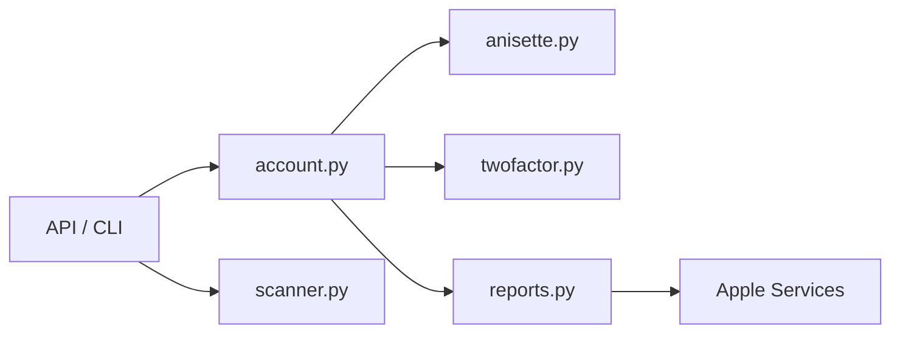

# malmeloo/FindMy.py

> Python library that queries Apple's Find My network to locate AirTags and devices, without a Mac.

## The problem
The code for Find My is scattered across several repositories, which makes integration difficult.

## What it actually does
It connects to an Apple account (SMS or trusted device for 2FA), fetches and decrypts location reports, and handles official AirTags and OpenHaystack accessories. It can also scan nearby Find My devices. The APIs are synchronous and asynchronous; a CLI (`python -m findmy`) is under construction.

## How it is wired


## Trying it
```bash
pip install findmy
python -m findmy
```

## Cost and gotchas
Free, but you need an Apple account. The protocol was reverse-engineered: Apple can change it without notice.

## What it is not
Not an official Apple service. The README says nothing about compliance with Apple's terms.

## Alternatives
No named alternative, apart from derived projects listed separately.

## For you
Worth watching if you want to exploit location data: useful for prototyping, but fragile because it depends on Apple.
