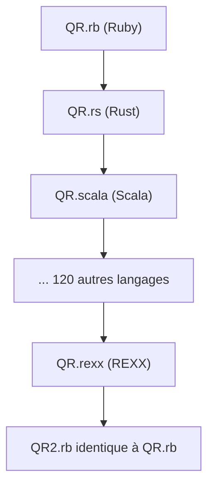

# mame/quine-relay

> Ruby program that generates a chain of 128 languages, until it recovers its own code, for esoterica enthusiasts.

## The problem
No practical problem: it is an artistic programming demonstration, a quine (a program that prints itself) run as a relay.

## What it actually does
`QR.rb` produces a Rust program, which produces a Scala program, and so on through 128 languages, until REXX regenerates the original Ruby code. The README lists the `apt-get` command for all the interpreters and compilers, then each step to run.

## How it is wired


## Trying it
```bash
docker build -t qr .
docker run --privileged --rm -e CI=true qr
make
diff QR.rb QR2.rb
```

## Cost and gotchas
Free, but compiling some files takes a lot of memory. Docker mode requires `--privileged`. No license declared: reuse rights are unclear. Targets Ubuntu 26.04 packages.

## What it is not
Not a reusable tool or library. Not lightweight: you have to install more than a hundred interpreters.

## Alternatives
- No alternative named in the README.

## For you
Ignore: fun to read, but of no use in data or MLOps, and no license declared.
