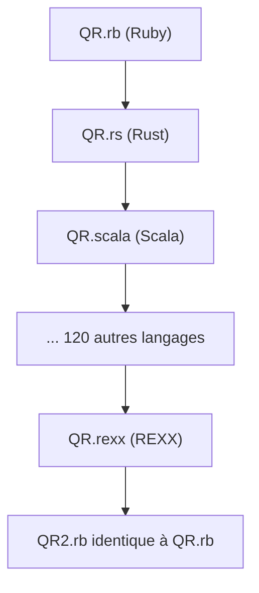

# mame/quine-relay

> Programme Ruby qui engendre une chaîne de 128 langages, jusqu'à retrouver son propre code, pour les curieux d'esoterisme.

## Le problème
Aucun problème pratique : c'est une démonstration artistique de programmation, un quine (programme qui s'affiche lui-même) en relais.

## Ce que ça fait vraiment
`QR.rb` produit un programme Rust, qui produit un programme Scala, et ainsi de suite à travers 128 langages, jusqu'à REXX qui régénère le code Ruby d'origine. Le README liste la commande `apt-get` pour tous les interpréteurs et compilateurs, puis chaque étape à lancer.

## Comment c'est branché


## Essayer
```bash
docker build -t qr .
docker run --privileged --rm -e CI=true qr
make
diff QR.rb QR2.rb
```

## Coût et pièges
Gratuit, mais la compilation de certains fichiers demande beaucoup de mémoire. Le mode Docker exige `--privileged`. Aucune licence déclarée : droits de réutilisation flous. Cible des paquets Ubuntu 26.04.

## Ce que ce n'est pas
Pas un outil ni une bibliothèque réutilisable. Pas léger : il faut installer plus d'une centaine d'interpréteurs.

## Alternatives
- Aucune alternative nommée dans le README.

## Pour toi
À ignorer : amusant à lire, mais sans usage en data ou MLOps, et sans licence déclarée.

