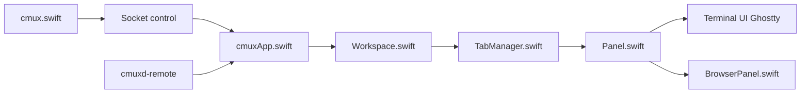

# manaflow-ai/cmux

> Native macOS terminal for driving several coding agents in parallel, with notifications and a built-in browser.

## The problem
With several Claude Code or Codex sessions open, you lose track of which agent is waiting for an answer.

## What it actually does
Swift/AppKit app on libghostty: vertical tabs showing git branch, PR, cwd, ports, latest notification.
Notification rings on panes (OSC 9/99/777 or `cmux notify`), scriptable built-in browser.
CLI and socket to create workspaces, splits, send keystrokes; remote SSH via a Go daemon.
Session restore and agent resumption via hooks.

## How it is wired


## Trying it
```bash
brew tap manaflow-ai/cmux
brew install --cask cmux
cmux hooks setup
```

## Cost and gotchas
Free; paid Founder's Edition for early access. macOS only. 5,093 open issues.

## What it is not
Not an agent orchestrator: a terminal with primitives. Does not keep processes alive without `cmux local-tmux`. Not usable on Linux/WSL.

## Alternatives
No alternative named in the README (tmux and Ghostty cited as comparisons).

## For you
Keep an eye on it: relevant only on a Mac with many agents in parallel; your WSL machine cannot run it.
