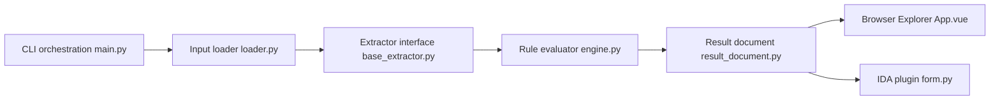

# mandiant/capa

> Command-line tool that lists what an executable or a sandbox report is capable of doing, for analysts.

## The problem
Faced with an unknown binary, finding its behaviors (network, persistence, encryption) by hand through reverse engineering is slow and depends on the analyst's experience.

## What it actually does
- Reads a PE, ELF, .NET module, shellcode or a sandbox report (CAPE, DRAKVUF, VMRay).
- Extracts features (called APIs, strings, constants), then compares them to YAML rules from the capa-rules repository.
- Displays the detected capabilities, mapped to ATT&CK and MBC; `-vv` shows the addresses that justify each detection.
- Warns when the sample looks packed: static analysis is then unreliable.

## How it is wired


## Trying it
```bash
capa.exe suspicious.exe
capa.exe suspicious.exe -vv
capa 05be49819139a3fdcdbddbdefd298398779521f3d68daa25275cc77508e42310.json
```

## Cost and gotchas
Free; standalone binaries to download from the releases. The rules are in a separate repository. The Ghidra backend goes through PyGhidra, the IDA integration requires IDA Pro.

## What it is not
Not an antivirus nor a verdict: the README talks about what the program "can" do. Packed or obfuscated samples give incomplete results. Use it only on files you are entitled to analyze.

## Alternatives
- capa Explorer Web: view the results in the browser.
- capa-rules: read or write the detection rules.

## For you
Worth watching: useful only if you do malware triage or artifact security (models, packages); otherwise outside your core field, despite a serious tool backed by Mandiant.
