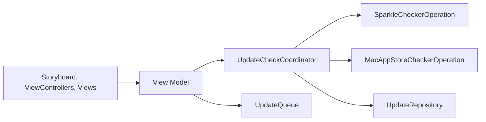

# mangerlahn/Latest

> Small macOS app that checks whether your applications are up to date, App Store and Sparkle.

## The problem
Knowing which Mac apps have an update, without opening them one by one.

## What it actually does
An `UpdateCheckCoordinator` launches checks (App Store via CommerceKit, Sparkle, Homebrew) and feeds `UpdateRepository` and its cache. Updates go through an `UpdateQueue`. MVVM architecture, no server: everything runs locally.

## How it is wired


## Trying it
```bash
brew install --cask latest
```

## Cost and gotchas
Free; donation optional. Developed in spare time: occasional updates. The use of private Apple frameworks for the App Store is described in the architecture.

## What it is not
Covers only the App Store and Sparkle according to the README (Homebrew appears in the architecture, not in the README).

## Alternatives
No alternative named in the README.

## For you
Ignore: a Mac desktop utility, outside the data/AI/MLOps scope.
