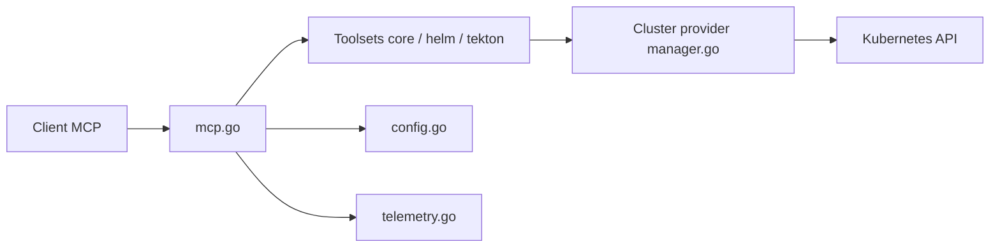

# manusa/kubernetes-mcp-server

> Go MCP server that exposes Kubernetes and OpenShift to an AI assistant, without going through kubectl.

## The problem
Giving an agent access to the cluster otherwise goes through fragile shell commands or kubectl/helm wrappers.

## What it actually does
Native binary talking directly to the Kubernetes API: CRUD on any resource, pods (logs, exec, top, run), events, nodes, scaling, Helm, and optional toolsets (Tekton, Kiali/Istio, KubeVirt, NetObserv, kcp). Multi-cluster via kubeconfig, read-only mode, denied resources (e.g. Secrets), TOML config, OAuth/OIDC over HTTP, OpenTelemetry, masking of sensitive data in logs.

## How it is wired


## Trying it
```bash
npx kubernetes-mcp-server@latest --help
uvx kubernetes-mcp-server@latest --help
kubernetes-mcp-server --config /etc/kubernetes-mcp-server/config.toml
```

## Cost and gotchas
Free; cluster access required. The tools can delete or modify: enable `read_only` and limit the toolsets, with a dedicated ServiceAccount.

## What it is not
Not an assistant: it is the tooling layer. The "115 open issues" signal a heavily solicited project.

## Alternatives
No alternative named in the README (it sets itself apart from kubectl/helm wrappers).

## For you
Adopt to connect an agent to a cluster, provided you lock down the permissions: Apache-2.0, single binary and active.
