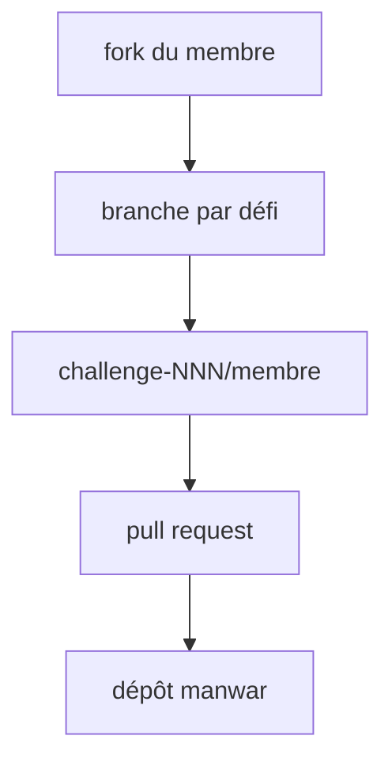

# manwar/perlweeklychallenge-club

> Central repository where Weekly Challenge members publish their solutions, mostly in Perl and Raku.

## The problem
A weekly programming challenge needs a place where everyone can submit and compare their solutions.

## What it actually does
One folder per challenge, one subfolder per member, then `perl` or `raku` with `ch-1.pl`, `ch-2.pl`, etc. Contributions are made through fork, branch and pull request. A `blog.txt` file can point to an article. The EZPWC tool helps with contributing.

## How it is wired


## Trying it
```bash
git clone https://github.com/joe-blog/perlweeklychallenge-club
cd perlweeklychallenge-club
git checkout -b new-branch
git add challenge-002/joe-blog
git commit
git push -u origin new-branch
```

## Cost and gotchas
Free. No license declared on this collection of third-party solutions.

## What it is not
Not a library or a tutorial: a collection of individual solutions, of varying quality.

## Alternatives
No alternative named in the README.

## For you
Ignore: Perl and Raku exercises unrelated to your data or AI work, and with no license.
