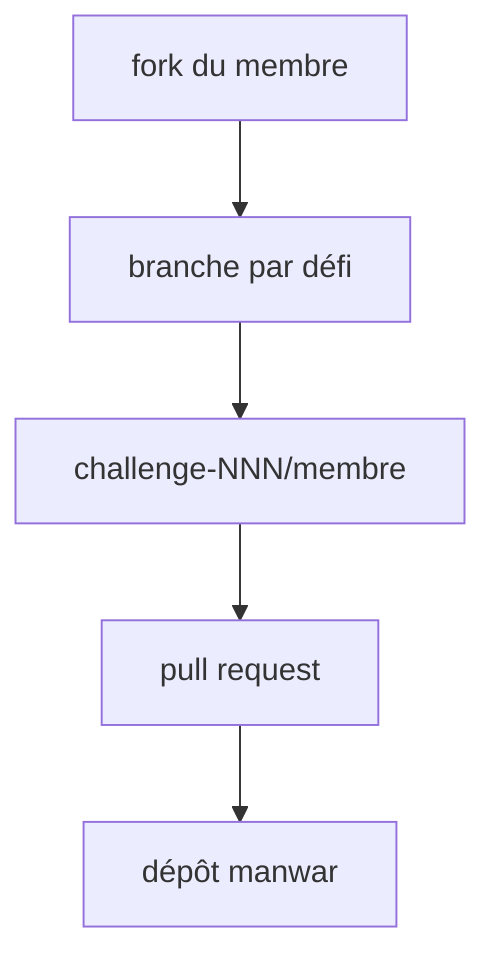

# manwar/perlweeklychallenge-club

> Dépôt central où les membres du Weekly Challenge publient leurs solutions, surtout en Perl et Raku.

## Le problème
Un défi de programmation hebdomadaire a besoin d'un endroit où chacun dépose et compare ses solutions.

## Ce que ça fait vraiment
Un dossier par défi, un sous-dossier par membre, puis `perl` ou `raku` avec `ch-1.pl`, `ch-2.pl`, etc. Les contributions se font par fork, branche et pull request. Un fichier `blog.txt` peut pointer vers un article. L'outil EZPWC aide à contribuer.

## Comment c'est branché


## Essayer
```bash
git clone https://github.com/joe-blog/perlweeklychallenge-club
cd perlweeklychallenge-club
git checkout -b new-branch
git add challenge-002/joe-blog
git commit
git push -u origin new-branch
```

## Coût et pièges
Gratuit. Aucune licence déclarée sur ce recueil de solutions de tiers.

## Ce que ce n'est pas
Pas une bibliothèque ni un tutoriel : un recueil de solutions individuelles, de qualité variable.

## Alternatives
Aucune alternative nommée dans le README.

## Pour toi
À ignorer : exercices Perl et Raku sans lien avec ton travail data ou IA, et sans licence.

