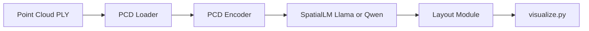

# manycore-research/SpatialLM

> Small 3D LLM that turns a point cloud into walls, doors, windows and object boxes.

## The problem
Going from a raw point cloud (video, RGBD, LiDAR) to a structured scene usable in robotics.

## What it actually does
A point cloud encoder (`pcd_encoder.py`) feeds a Llama or Qwen LLM (0.5 to 1 billion parameters). The output is a layout text decoded by the `layout` module and viewable with `rerun`. Version 1.1 accepts a list of categories among 59. A test set of 107 point clouds is provided.

## How it is wired


## Trying it
```bash
huggingface-cli download manycore-research/SpatialLM-Testset pcd/scene0000_00.ply --repo-type dataset --local-dir .
python inference.py --point_cloud pcd/scene0000_00.ply --output scene0000_00.txt --model_path manycore-research/SpatialLM1.1-Qwen-0.5B
python visualize.py --point_cloud pcd/scene0000_00.ply --layout scene0000_00.txt --save scene0000_00.rrd
```

## Cost and gotchas
Tested with Python 3.11, PyTorch 2.4.1 and CUDA 12.4. Building torchsparse or flash-attn is long. License not recognized by GitHub.

## What it is not
Not a general-purpose model: point clouds aligned on the z axis. Scores are measured on the project's own datasets; zero-shot detection on videos remains modest for several categories.

## Alternatives
- SceneScript, RoomFormer, V-DETR: compared in the README benchmarks.

## For you
Worth watching: interesting if you do 3D vision or robotics, but the license needs clarifying and setup is heavy.
